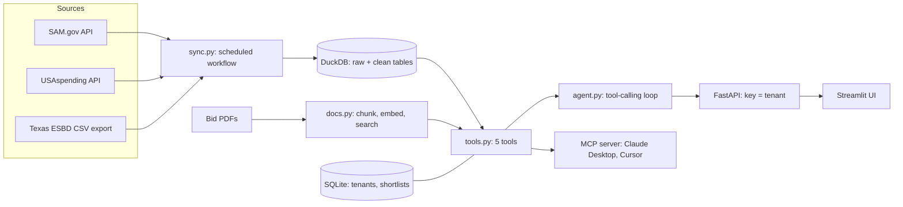

# Texas Contract Finder

A multi-tenant AI agent that helps small businesses find federal and Texas government contracts,
reads the bid documents, and scores fit with citations. Built end to end on real public data:
SAM.gov, USAspending and the Texas ESBD.

Ask it *"What contracts are open for us, and should we bid on the best two?"* and it searches
opportunities matched to your industry codes, reads the relevant pages of the bid package, and
returns a fit score with blockers (service area, bonding capacity, deadline) and page citations.

## Architecture



| Layer | Files | What it does |
|---|---|---|
| Data | `sam.py`, `usaspending.py`, `esbd.py`, `sync.py`, `db.py` | Pull, validate and load raw data into raw (bronze) and clean (silver) tables |
| Model | `fit.py`, `docs.py` | Structured fit scoring (Pydantic-validated JSON) and RAG over bid PDFs |
| Harness | `agent.py` | The agent loop: tools, step limit, cost tracking, JSONL logs |
| Tools | `tools.py` | Plain Python functions; the harness injects the tenant |
| Interfaces | `api.py`, `ui.py`, `mcp_server.py` | REST API, web UI, and MCP for Claude Desktop and Cursor |
| Quality | `tests/`, `evals.py`, `evals/cases.jsonl` | 30 unit tests and 9 eval cases run against the real model |
| Infra | `Dockerfile`, `compose.yaml` | One image, API and UI containers, secrets at runtime |

## Real-world problems it handles

| Problem | What I built |
|---|---|
| A source with no API that blocks bots (Texas ESBD's robots.txt disallows all crawlers) | A manual CSV export dropped in a folder, like an SFTP drop. The loader validates columns, dedupes to the newest version, checks that rows balance (read = loaded + duplicates + skipped), and swaps the data in one transaction |
| A rate-limited API (SAM.gov allows a few calls a day) | A daily budget counted before each call, a 12-hour cache, and retries only on 429/5xx with backoff |
| Two code systems (federal NAICS vs Texas NIGP) | A NAICS-to-NIGP mapping built by profiling the real data, kept as a reviewable JSON file |
| Messy real data | Deadlines in each agency's time zone (converted to US Central and always labeled), codes with leading zeros, line breaks and `;` inside fields, an export capped at 20,000 rows |
| Many clients, one system | Four tenant locks: the API key decides the tenant; the harness injects it so the model never chooses it; every private query filters by tenant; tests prove it, including a model that tries to pass another tenant's ID |
| Long bid packages | RAG: chunks with file names and page numbers, cosine search, citations in every answer |
| Trustworthy scoring | The model lists facts and blockers; code enforces the rule (any blocker caps the score at 49) so scores are consistent |

## Measured results

Evals: 9 cases built from real failures and guardrails, each run 3 times because answers vary between runs.

| Run | Pass rate | What changed |
|---|---|---|
| First baseline | 6/9 (67%) | Starting point, with a checker bug |
| Fixed checker | 7/9 (78%) | Only the checker: the model writes a curly apostrophe (’), the checker matched a straight one (') |
| Tool-description fix, x3 | 25/27 (93%) | Rewrote the `read_document` description and two prompt rules |
| gpt-5.4-nano, x3 | 22/27 (81%) | Same cases, about 3x cheaper, but failed the document-honesty case 3 of 3 |

Retrieval: on three known answers, meaning-only search put 3 of 3 in the top 5; hybrid
(meaning + keywords) found 2 of 3 and pushed the deadline chunk from rank 1 to rank 11, so
meaning-only is the default and hybrid stays behind a flag.

Cost: a typical question costs $0.002 to $0.007 with gpt-5.4-mini.

## Run it locally

Requires Python 3.13. On macOS:

```bash
python3 -m venv .venv && source .venv/bin/activate
pip install -r requirements.txt
cp .env.example .env              # then fill in OPENAI_API_KEY and SAM_API_KEY
python seed_tenants.py            # creates two example businesses and prints their API keys once
python sync.py --naics 238220     # pulls SAM.gov and USAspending data
pytest -q                         # 30 tests, no API calls
```

Texas ESBD: export open solicitations from txsmartbuy.gov/esbd ("Export to CSV"), save the file
in `data/esbd_drop/`, then run `python sync.py --naics 238220 --skip sam usaspending`.

Ask the agent from the terminal:

```bash
python agent.py lonestar-hvac "What contracts are open for us, and check the best 2?"
python evals.py --label my-run --repeat 3
```

Run the API and the UI (two terminals), or both with Docker:

```bash
uvicorn api:app --reload          # http://127.0.0.1:8000/docs
streamlit run ui.py               # http://localhost:8501, sign in with a business API key
docker compose up --build         # both, in containers
```

## Use the tools from Claude Desktop or Cursor (MCP)

`mcp_server.py` exposes the same tools over the Model Context Protocol. Each server process
serves exactly one tenant, set by `MCP_TENANT_ID`, and refuses to start without one. It is
read-only. Example Claude Desktop entry (`claude_desktop_config.json`):

```json
{
  "mcpServers": {
    "contract-finder-hvac": {
      "command": "/absolute/path/to/.venv/bin/python",
      "args": ["/absolute/path/to/mcp_server.py"],
      "env": {"MCP_TENANT_ID": "lonestar-hvac"}
    }
  }
}
```

Cursor uses the same shape in `.cursor/mcp.json`.

## Security

- Secrets live only in `.env`, which is never committed or copied into the Docker image.
- HTTP errors and logs never include URL parameters, because the SAM.gov key travels in the URL.
- The tenant's API key is never sent to the model, and SAM.gov contact records stay in the raw layer.
- Document text is treated as data, not instructions (prompt-injection rule), and API callers
  cannot inject system messages through conversation history.
- Business rules (minimum days before a deadline, score caps) are enforced in code, not left
  to the model.

## Deploying to Azure (plan)

Azure Container Apps (scale to zero), Azure Container Registry for the image, Key Vault for
secrets, Azure Files or a managed database for the data, an Azure Functions timer for the daily
sync, Application Insights for logs, and Entra ID sign-in instead of API keys. Two practical
steps: build the image for `linux/amd64` (Apple Silicon builds ARM by default) and move the
evals to a frozen copy of the database so results are reproducible.

## Known issues

- Two eval cases are flaky (2 of 3 passes): the model sometimes presents fewer opportunities than it found.
- Some SAM.gov projects appear twice under different notice IDs (not yet investigated); deduping on solicitation number is the likely fix.
- Texas ESBD documents can't be read automatically, so Texas fit checks use the notice fields only, and say so.
- USAspending returns the largest awards first, so award summaries are biased toward big contracts.
- The ESBD export truncates long code lists ("(more...)"), so a few NIGP codes can be missing.

## What I'd do next

Structured profile fields (service area, bonding capacity) so impossible jobs are filtered in
code before any model call; hashed API keys; a larger eval set with an LLM judge for fuzzy
checks; per-task model routing (for example nano for fit checks if evals allow it); and the
Azure deployment above.
